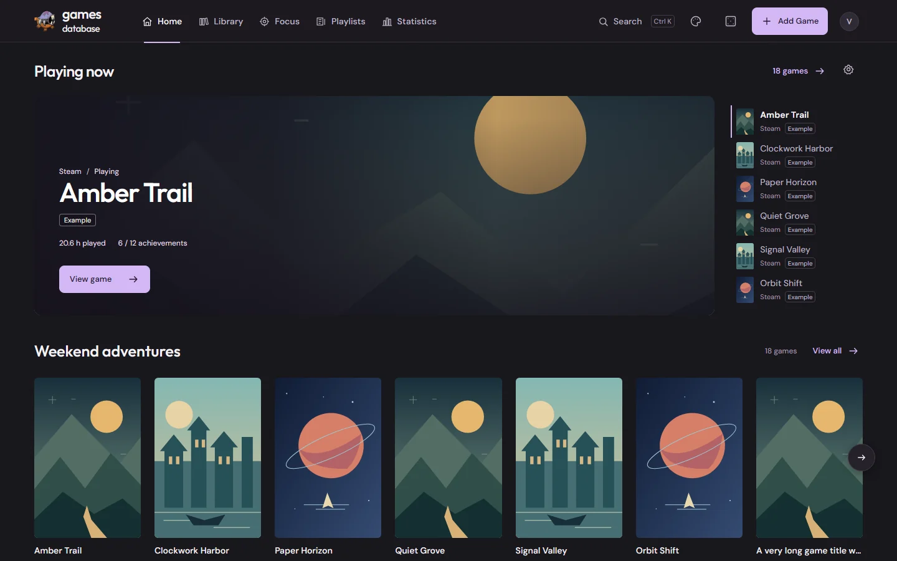
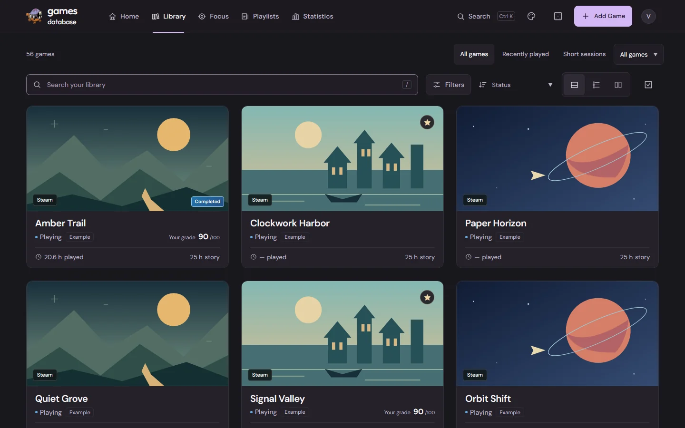
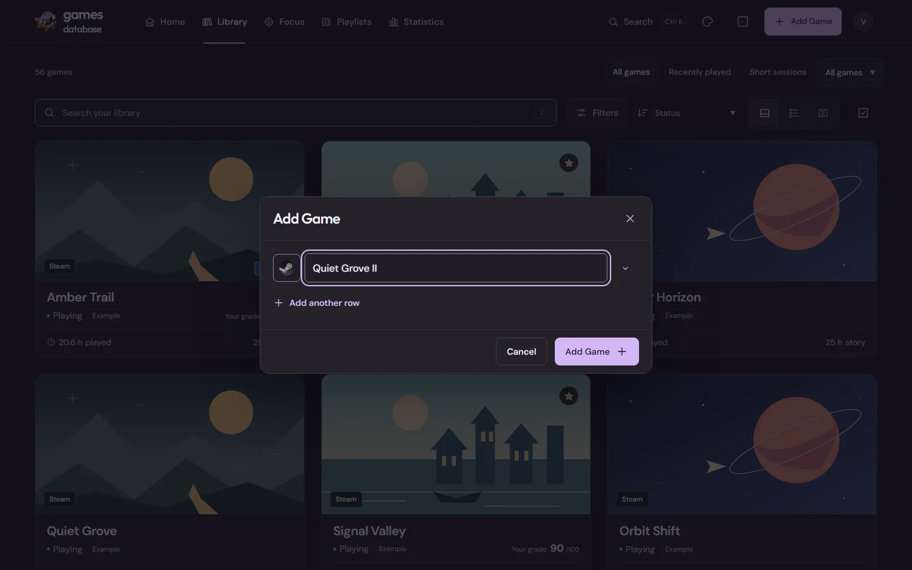
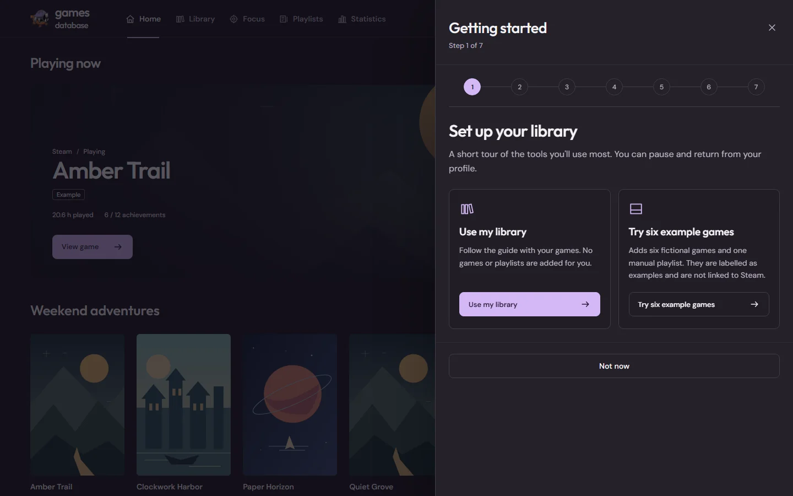

# Games Database

**Tu colección, tu progreso y tu próximo juego, en una misma biblioteca.**

Games Database es una aplicación React autoalojada con una API ASP.NET Core
multiusuario. Organiza tus juegos, conserva tus partidas, conecta Steam cuando
lo necesites y vuelve a descubrir lo que ya tienes en tu colección.

[English](README.md) · [Primeros pasos](docs/GETTING_STARTED.es.md) ·
[Guía de uso](docs/USER_GUIDE.es.md) · [API](https://github.com/David-H-Afonso/GamesDatabase.Api)



Las capturas muestran la aplicación ejecutándose con registros ficticios aislados
y las ilustraciones de ejemplo incluidas, sin datos personales ni de producción.

## Qué puedes hacer

- **Crear tu biblioteca:** alta individual o por lotes compacta, con icono Steam
  junto al título y opciones plegadas; edita notas, fechas, comentarios, estimaciones
  y Logo, Hero y Cover independientes.
- **Buscar y organizar:** frases/exclusiones literales, filtros avanzados, vistas
  guardadas, playlists manuales/automáticas, carpetas y estanterías.
- **Elegir presentación:** Covers, Cards y Row compacto/ampliado; trece temas,
  fondos optativos e interfaz completa en inglés y español.
- **Registrar progreso:** partidas/Replays separados, historial de cambios,
  tiempo manual que sustituye o se suma a Steam y conjuntos distintos de juego base/DLC.
- **Personalizar Inicio:** ordena, oculta y configura filas sin cambiar sus
  playlists de origen. Jugando ahora tiene una lista lateral discreta y separada.
- **Elegir qué jugar:** recomendaciones diarias con estados incluidos/excluidos
  y un dado con ámbito de toda la biblioteca o solo la página mostrada.
- **Completar información:** Steam primero y Wikidata después, con fuente por
  campo, opciones de rellenar vacíos/sobrescribir y revisión antes de guardar.
- **Aprender a tu ritmo:** guía opcional y reanudable para usuarios nuevos o
  existentes; los ejemplos requieren aceptación y se pueden conservar o borrar.
- **Mover y proteger datos:** CSV/JSON/ZIP, importación con control de propiedad,
  backups y administración de usuarios y catálogos personales.



## Inicio rápido

### Requisitos

- Node.js **22.13+** o una versión posterior soportada; CI utiliza Node 22.
- npm **10+** y el `package-lock.json` raíz versionado.
- [GamesDatabase.Api](https://github.com/David-H-Afonso/GamesDatabase.Api) **3.0**
  ejecutándose en una URL accesible desde el navegador.

```sh
git clone https://github.com/David-H-Afonso/GamesDatabase.Front.git
cd GamesDatabase.Front
npm ci --include=optional
npm run dev
```

Abre `http://localhost:5173`. En desarrollo se usa HTTPS local en el puerto 7245,
con alternativa HTTP en el 5011. Para elegir explícitamente HTTP, crea un `.env` local no versionado
con esta URL pública para el navegador:

```env
VITE_API_URL=http://127.0.0.1:5011/api
```

No incluyas claves JWT, Steam ni otros secretos del servidor en variables del
Front. Vite redirige `/game-images` a la API local. La instalación pareada y la
primera cuenta están en [Primeros pasos](docs/GETTING_STARTED.es.md).

## Primer uso

1. Entra con tu cuenta. Una instalación nueva ofrece el administrador inicial;
   establece su contraseña antes de compartir acceso.
2. Elige **Usar mi biblioteca** o acepta los seis juegos de ejemplo identificados.
   Saltar la guía nunca añade ejemplos.
3. Añade un juego, abre su ficha y usa **Editar ficha** para guardar campos cambiados.
4. Crea playlists o una selección pequeña en Focus. Personaliza Inicio por separado.
5. Usa las recomendaciones o el dado para volver a tu colección.

El perfil permite reanudar/reiniciar la guía y gestionar ejemplos pendientes.
Al crear o editar usuarios, un administrador puede activar la guía mediante un check.





## Desarrollo y comprobación

```sh
npm run build
npm run lint
npm run test
npm run test:coverage
npm run test:i18n
npm run test:versioning
node scripts/ci/native-lock.mjs
node scripts/ci/native-lock.mjs --installed
npm run security:all
```

Para probar el artefacto compilado, arranca la preview en otro terminal:

```sh
npm run build
npm run preview -- --host 127.0.0.1 --port 5174 --strictPort
```

```sh
npm run cypress:run -- --browser electron --config baseUrl=http://127.0.0.1:5174
```

Cypress utiliza autenticación ficticia y contratos API interceptados. Las
peticiones API no previstas quedan bloqueadas; no uses datos personales o de
producción. Su navegador Electron no es la aplicación de escritorio independiente.

## Arquitectura y decisiones

React 19/TypeScript/Vite 7, Redux Toolkit, React Router 7, SCSS, Vitest, Testing
Library, MSW y Cypress. DM Sans y Outfit se sirven localmente.

Los contratos HTTP están en `src/services` y `src/models`. Las lecturas se
identifican por cuenta/consulta, cancelan resultados antiguos y se separan de las
mutaciones explícitas. Ficha y autorrellenado viven fuera de las tarjetas
reemplazables para conservar un flujo abierto cuando se actualiza la lista.

- **Edición parcial:** Guardar envía campos cambiados, no una copia completa antigua.
- **Imágenes independientes:** la falta de Hero no se rellena con una Cover vertical.
- **Cambios explícitos:** consultar no sincroniza jugadores; plantillas/ejemplos
  no se crean de forma silenciosa; los conflictos se muestran para revisar.
- **Descubrimiento en servidor:** todos comparten el día UTC, pero cada selección
  de recomendaciones o juego aleatorio pertenece a su propia colección.

Consulta [Arquitectura](docs/ARCHITECTURE.es.md) y [Contribuir](CONTRIBUTING.es.md).

## Definiciones y límites

Los minutos manuales positivos sustituyen a Steam por defecto. **Cero o vacío
recupera Steam**; **Sumar tiempo manual a Steam** combina ambas fuentes.
Los valores manuales/Steam se mantienen separados en editor y transferencias.
Historia/completista son horas estimadas, no progreso. Completado incluye marca
manual, completado conservado o conjuntos completados; 100% estricto exige todos
los logros públicos actuales de juego y DLC. Replays conserva sus propias fechas
y notas, no una duración ni sesiones mensuales inventadas.

Estas fuentes de metadatos no ofrecen estimaciones verificadas de duración;
las existentes se conservan. La disponibilidad de Steam Store y la cobertura de
Wikidata varían. Un dato ausente o ambiguo no borra el campo anterior. Los ejemplos
cuentan en la biblioteca hasta que se conservan o eliminan.

Este repositorio es el **frontend web**, no una release Electron. Un test local
correcto no certifica despliegue, dispositivos físicos o lectores de pantalla.
Producción requiere revisar hosting, política de acceso y recuperación reales.

## Desplegar y publicar

`npm run build` genera `dist/`. El contenedor inyecta `window.ENV.VITE_API_URL`
y utiliza `API_IMAGES_URL` para el proxy Nginx. Navegador y contenedor no usan
necesariamente las mismas URLs.

Actualiza primero la API compatible y sigue [Despliegue y recuperación](docs/DEPLOYMENT.md).
Un push puede publicar imágenes/releases, no autoriza arrancar producción ni
restaurar SQLite. El [kit de versiones](scripts/versioning/README.md) valida
versiones por commit; `Release-As: 3.0.0` registra el hito de producto elegido
sin declarar un cambio incompatible de API ficticio.

## Problemas y soporte

- **Falta un módulo nativo:** utiliza el lock portátil y `npm ci --include=optional`;
  no lo reconstruyas desde dependencias podadas. Ejecuta los guards nativos.
- **API/imágenes inaccesibles:** revisa por separado URL pública y proxy de imágenes.
- **Conflicto 409:** recarga y revisa; no fuerces la sobrescritura.
- **Sin recomendaciones:** ajusta estados o añade juegos elegibles. Una colección
  pequeña puede repetir juegos; el orden cambia cada día.
- **Conflicto al borrar ejemplos:** recarga/revisa para no descartar otro cambio.

Abre un bug reproducible en [Issues](https://github.com/David-H-Afonso/GamesDatabase.Front/issues).
Las comprobaciones de contribución y los reportes sensibles se explican en
[Contribuir](CONTRIBUTING.es.md). Para reportes sensibles, sigue
[Seguridad](SECURITY.md) sin divulgar detalles en público.

## Licencia

La aplicación conserva su [GPL-3.0](LICENSE.md). Las fuentes mantienen los avisos
SIL Open Font License originales en `public/licenses/fonts/`, distribuidos con
el artefacto. Las imágenes de juegos pertenecen a sus titulares. Las ilustraciones
de ejemplo se distribuyen con la app y no representan ediciones comerciales.
