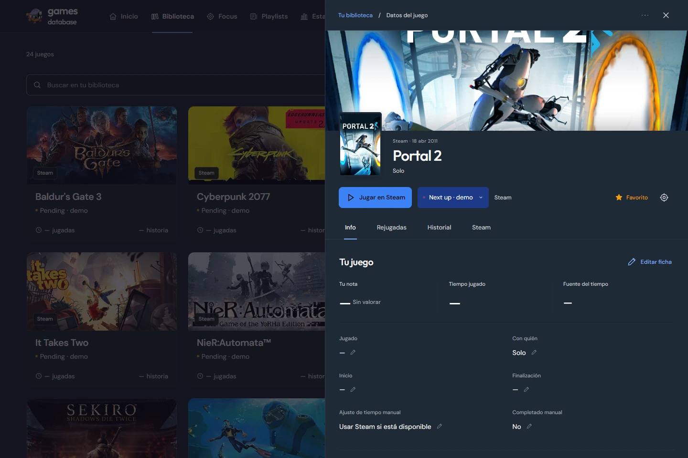
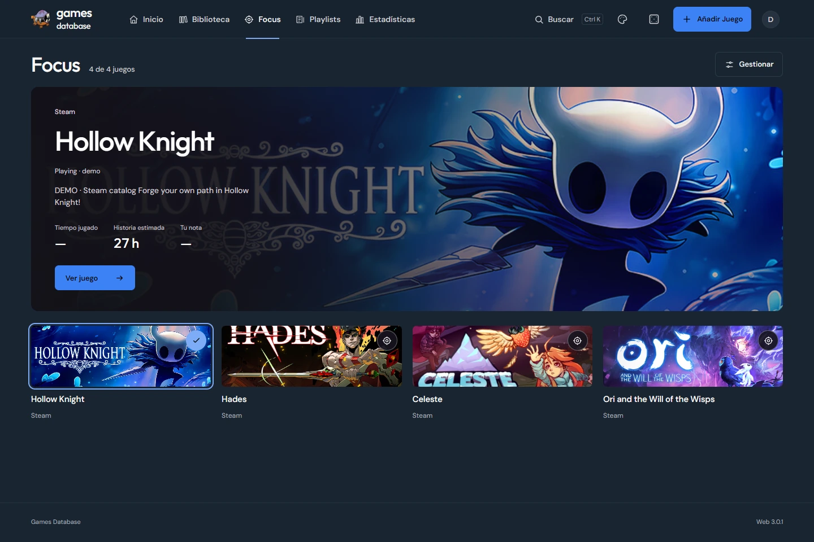
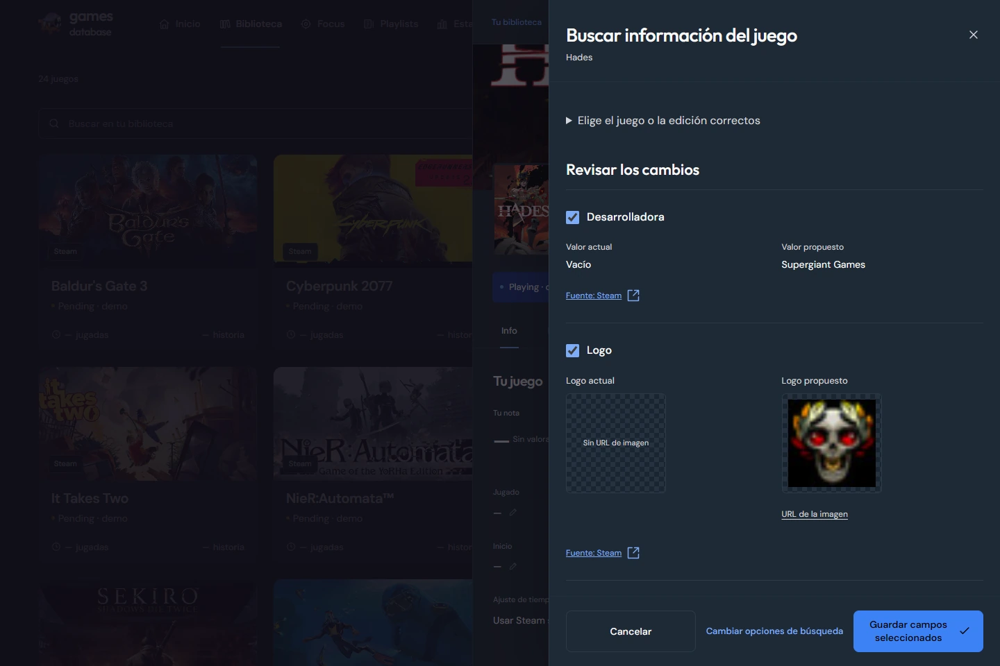
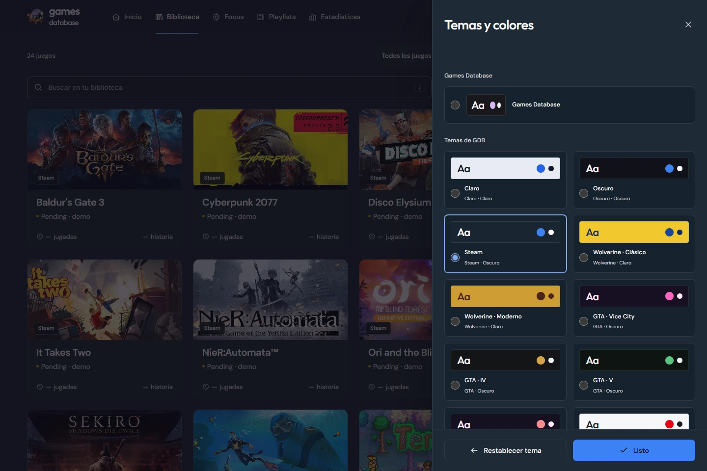

# Games Database

[English](README.md) · [Español](README.es.md) · [API](https://github.com/David-H-Afonso/GamesDatabase.Api) · [Versiones](https://github.com/David-H-Afonso/GamesDatabase.Front/releases)

Games Database es una aplicación autoalojada para organizar tu colección de
videojuegos y llevar el seguimiento de tus partidas. Se ejecuta en tu propio
servidor, con una biblioteca independiente para cada usuario.


## Funciones

- **Una biblioteca fácil de consultar.** Filtra por plataforma, estado, favoritos,
  notas y otros criterios. Guarda las vistas que uses a menudo y elige entre
  carátulas, tarjetas o filas.
- **Playlists y estanterías.** Prepara una lista ordenada o crea una automática
  mediante reglas. Agrúpalas en carpetas, explora sus carátulas en Estanterías y
  reserva Focus para una selección pequeña. Inicio puede mostrar tus listas y
  vistas habituales.
- **Registro de partidas.** Guarda fechas, tiempo, notas y comentarios, con registros
  separados para las rejugadas y estadísticas de toda tu colección.
- **Steam e información de los juegos.** Importa tu biblioteca de Steam, consulta
  logros y revisa datos de Steam y Wikidata, críticas y estimaciones de HLTB a través
  de Deku Deals. El autorrellenado por lotes continúa en segundo plano mientras
  utilizas la aplicación.
- **A tu gusto.** Elige entre 13 temas e interfaz en español o inglés. Administra
  usuarios y catálogos, e importa o exporta tu biblioteca con las herramientas
  CSV, JSON y ZIP.


## Ejecutar en local

Necesitas Node.js **22.13+**, npm **10+** y tener en marcha la
[API de Games Database](https://github.com/David-H-Afonso/GamesDatabase.Api).
La [guía de instalación](docs/GETTING_STARTED.es.md) explica cómo preparar ambos
repositorios y la primera cuenta.

```sh
git clone https://github.com/David-H-Afonso/GamesDatabase.Front.git
cd GamesDatabase.Front
npm ci --include=optional
npm run dev
```

Abre **http://localhost:5173**. En desarrollo se usa la API local por HTTPS en el
puerto 7245, con HTTP en el 5011 como alternativa. Para usar HTTP directamente,
añade esta URL pública a `.env.local`:

```env
VITE_API_URL=http://127.0.0.1:5011/api
```

En una instalación nueva, entra con el administrador inicial y establece su
contraseña antes de compartir el acceso. La guía inicial explica cómo añadir juegos
y organizar la biblioteca; puedes omitirla o retomarla desde el menú de perfil.

### Configuración

| Ajuste | Uso |
| --- | --- |
| `VITE_API_URL` | URL de la API en desarrollo y durante la compilación |
| `window.ENV.VITE_API_URL` | URL de la API para el navegador, configurada por el contenedor web |
| `API_IMAGES_URL` | Dirección de la API que utiliza el proxy de imágenes del contenedor |

No incluyas claves de firma JWT ni claves API de Steam en estas variables del
frontend. Para contenedores, imágenes y actualizaciones, consulta
[Despliegue](docs/DEPLOYMENT.es.md).

## Capturas

<details>
<summary>Fichas, playlists, Focus y otras pantallas</summary>

### Ficha de un juego



### Playlists


### Estanterías


### Focus



### Revisión de información



### Estadísticas


### Apariencia



</details>

Las capturas utilizan una biblioteca de demostración. [Créditos de las imágenes](docs/SCREENSHOTS.es.md).

## Desarrollo

El frontend utiliza React 19, TypeScript, Vite, Redux Toolkit y SCSS. Las pruebas
se ejecutan con Vitest, Testing Library, MSW y Cypress.

```sh
npm run build
npm run lint
npm run test
```

[Contribuir](CONTRIBUTING.es.md) detalla las comprobaciones de cobertura, navegador y
versionado. La [guía de arquitectura](docs/ARCHITECTURE.es.md) describe la estructura
de la aplicación.

## Documentación y soporte

| Guía | Contenido |
| --- | --- |
| [Primeros pasos](docs/GETTING_STARTED.es.md) | Instalar la API y el cliente web, y crear una biblioteca |
| [Guía de uso](docs/USER_GUIDE.es.md) | Juegos, filtros, playlists, Focus y herramientas de datos |
| [Información y autorrellenado](docs/METADATA_AUTOFILL.es.md) | Fuentes, revisión de campos y lotes en segundo plano |
| [Despliegue y recuperación](docs/DEPLOYMENT.es.md) | Contenedores, configuración, copias de seguridad y actualizaciones |

Si la aplicación no conecta con la API, revisa su URL y el origen permitido para el
navegador. Si fallan las imágenes, comprueba el proxy por separado. Cuando falte un
módulo nativo, reinstala con `npm ci --include=optional` y el lockfile del repositorio.

Puedes comunicar errores en [Issues](https://github.com/David-H-Afonso/GamesDatabase.Front/issues).
Para problemas de seguridad, sigue [SECURITY.md](SECURITY.md).

## Licencia

[GPL-3.0-or-later](LICENSE.md). Las fuentes incluidas conservan sus avisos Open Font
License en `public/licenses/fonts/`. Las imágenes de los juegos pertenecen a sus titulares.
