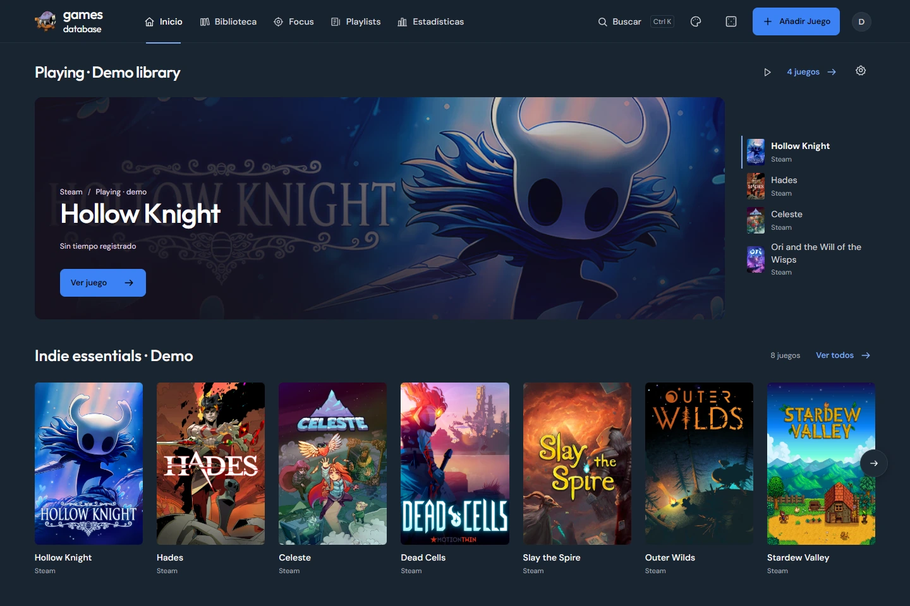
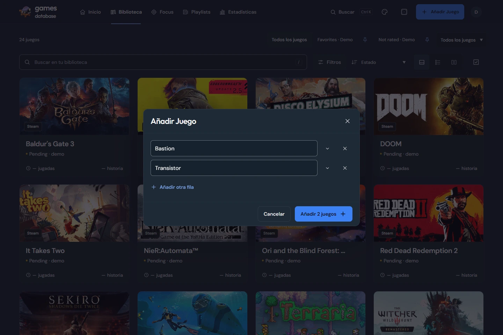
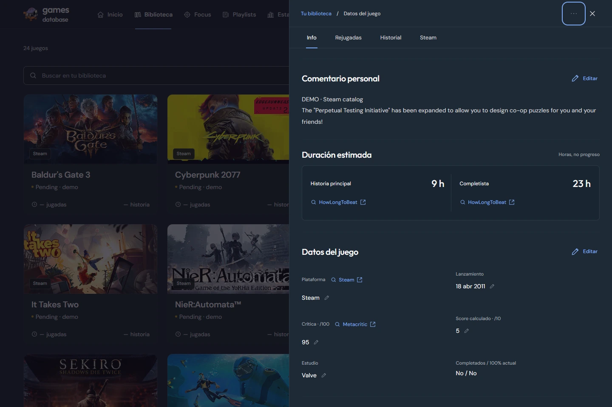
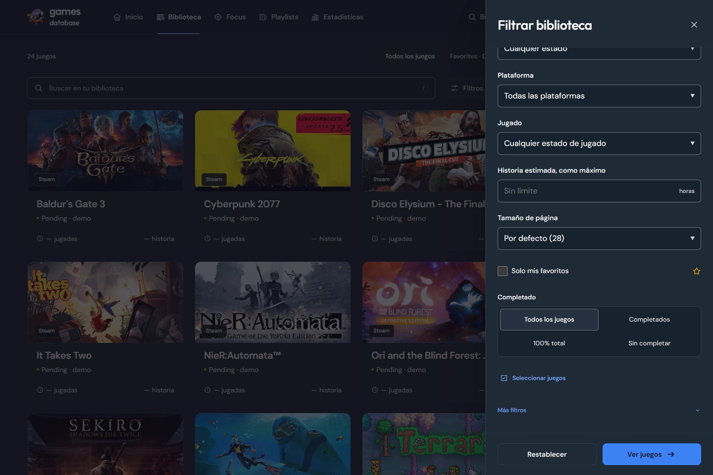
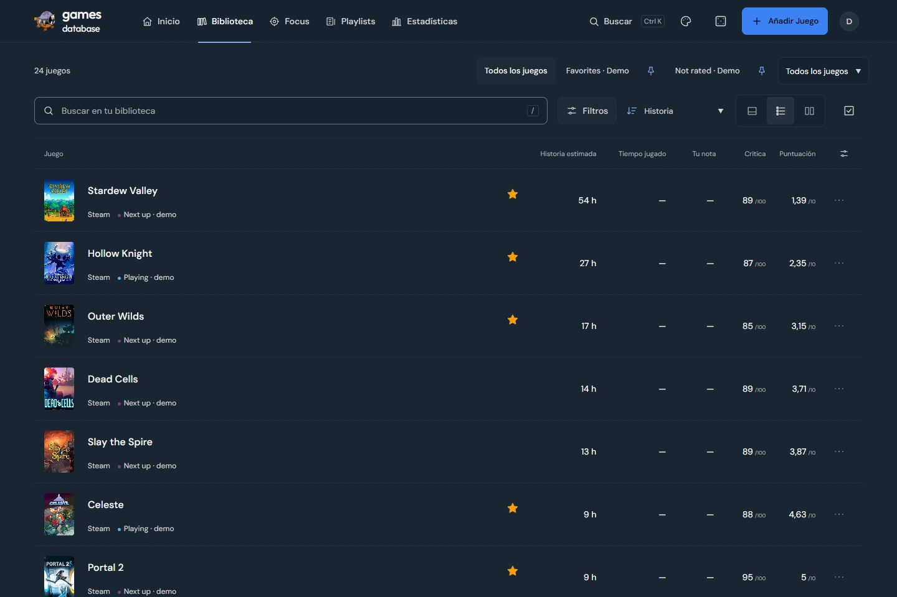
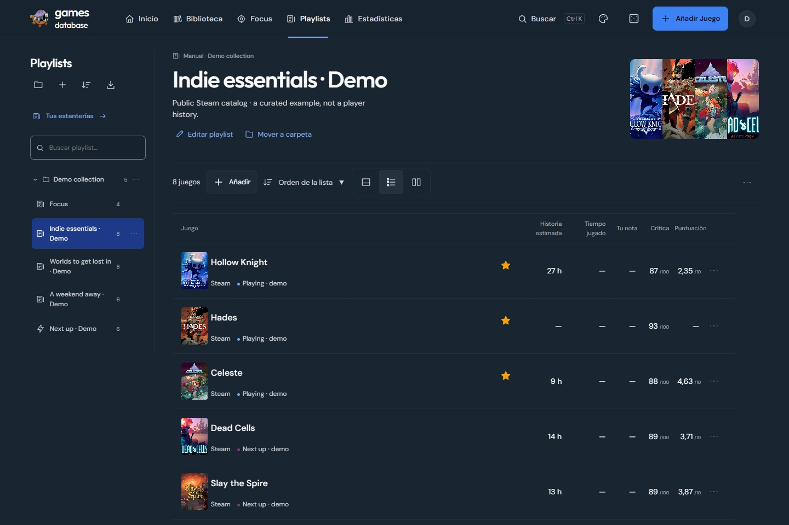
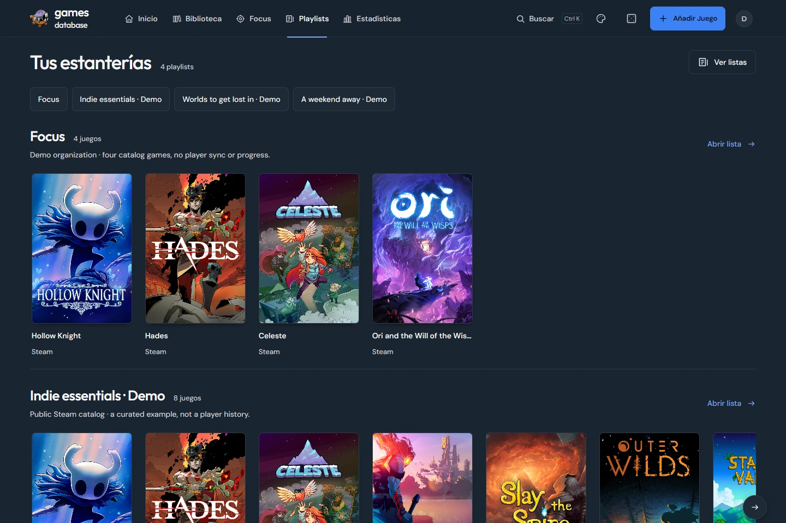
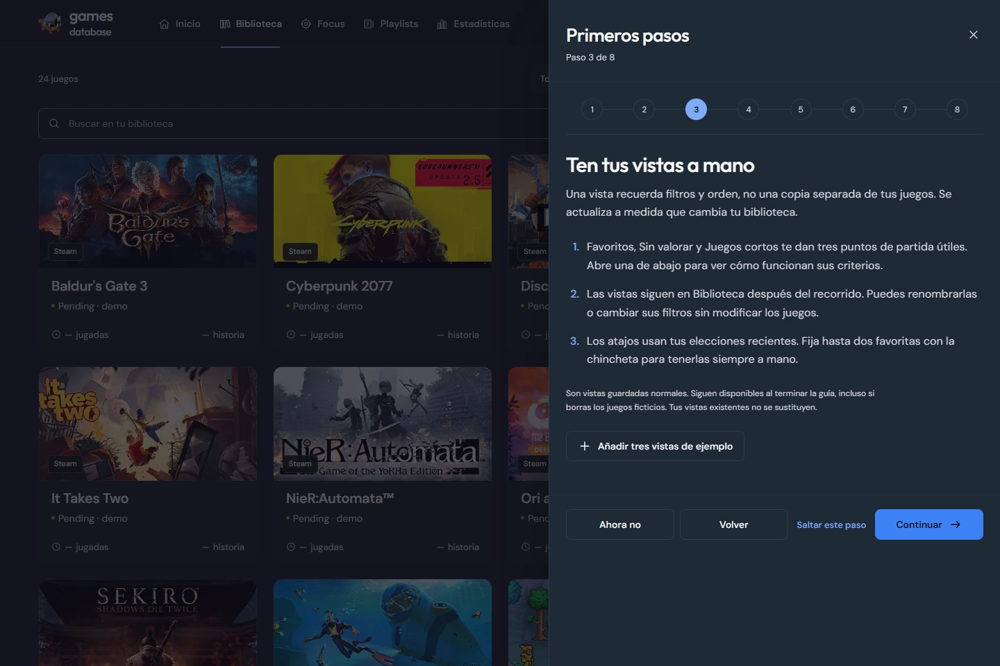

# Games Database

[English](README.md) · [Español](README.es.md) · **Frontend web** ·
[API: English](https://github.com/David-H-Afonso/GamesDatabase.Api/blob/HEAD/README.md) /
[Español](https://github.com/David-H-Afonso/GamesDatabase.Api/blob/HEAD/README.es.md)

**Tu colección, tu progreso y tu próximo juego, en una misma biblioteca.**

Games Database es una aplicación React autoalojada con una API ASP.NET Core
multiusuario. Organiza tus juegos, conserva tus partidas, conecta Steam cuando
lo necesites y vuelve a descubrir lo que ya tienes en tu colección.

[Inicio rápido](#inicio-rápido) · [Recorrido](#un-recorrido-por-tu-biblioteca) ·
[Guía de uso](docs/USER_GUIDE.es.md) · [Instalación pareada](docs/GETTING_STARTED.es.md)



> **App real, colección de demostración independiente.** Estas capturas usan 24 juegos
> famosos y datos/imágenes públicos del catálogo Steam en una cuenta aislada. Estados,
> favoritos y listas ilustran organización; no se han copiado ni inventado cuentas de
> jugadores, logros, tiempo jugado, notas o fechas de partida.
> [Fuentes y alcance de las capturas](docs/SCREENSHOTS.es.md).

**Código y releases:** esta guía sigue el código del repositorio; una copia con cambios
sin commit no tiene por qué coincidir con la última imagen. El baseline comprobado
antes del seguimiento del 27 de noviembre era Front **3.0.1** / API **3.0.0**. Consulta
versión/SHA exactos en [releases Web](https://github.com/David-H-Afonso/GamesDatabase.Front/releases)
y [releases API](https://github.com/David-H-Afonso/GamesDatabase.Api/releases).
Duraciones/crítica, chinchetas, fechas revisadas y autorrellenado por lotes requieren
la API posterior compatible; aparecer en el código no demuestra que una imagen antigua lo incluya.

## Qué puedes hacer

- **Crear tu biblioteca:** alta individual o por lotes compacta, opciones plegadas e
  icono Steam junto al título en cuentas vinculadas; edita notas, fechas, comentarios, estimaciones
  y Logo, Hero y Cover independientes.
- **Buscar y organizar:** frases/exclusiones literales, filtros avanzados, vistas
  guardadas con dos atajos fijados, playlists manuales/automáticas, carpetas y estanterías.
- **Elegir presentación:** Covers, Cards y Row compacto/ampliado; trece temas,
  fondos optativos e interfaz completa en inglés y español.
- **Registrar progreso:** partidas/Replays separados, historial de cambios,
  tiempo manual que sustituye o se suma a Steam y conjuntos distintos de juego base/DLC.
- **Personalizar Inicio:** ordena, oculta y configura filas sin cambiar sus
  playlists de origen. Jugando ahora rota cada 20 segundos mientras está visible,
  con pausa discreta y protección durante interacción/movimiento reducido.
- **Elegir qué jugar:** recomendaciones diarias con estados incluidos/excluidos
  y un dado con ámbito de toda la biblioteca o solo la página mostrada.
- **Completar información:** Steam primero y Wikidata después, con fuente por
  campo, imágenes independientes y estimaciones HLTB atribuidas desde páginas
  públicas de Deku Deals; revisa los campos propuestos antes de guardar.
- **Aprender a tu ritmo:** guía opcional y reanudable para usuarios nuevos o
  existentes; los juegos de ejemplo requieren aceptación y las vistas útiles se conservan.
- **Mover y proteger datos:** CSV/JSON/ZIP, importación con control de propiedad,
  backups y administración de usuarios y catálogos personales.


## Un recorrido por tu biblioteca

### 1. Añade un título, no un formulario lleno de obligaciones

1. Pulsa **Añadir juego** y empieza por el título. Si la cuenta está vinculada a Steam,
   el icono adyacente activa/desactiva búsquedas de biblioteca/tienda por fila. Sin
   vincular un jugador siguen disponibles el alta manual y la revisión pública de metadatos.
2. Despliega opciones secundarias cuando necesites estado, plataforma u otros campos
   del alta. Añade filas para un lote: cada una conserva su borrador y resultado.
3. Si el alta terminó pero falló un ajuste posterior, revisa ese resultado en lugar de
   añadir el mismo juego otra vez. Los reintentos manuales usan un UUID por fila.



Abre carátula o título para ver la ficha. **Editar ficha** separa datos personales,
catálogo, imágenes y vínculo Steam. **Logo**, **Hero** horizontal y **Cover** vertical
son independientes; cada preview muestra el rol exacto. Nota/Crítica usan **/100**
y el Score calculado **/10**.




### 2. Encuentra algo que apetezca jugar

1. Busca por frases y exclusiones literales; elige coincidencia cualquiera/todas y
   sensibilidad independiente a mayúsculas/acentos en las opciones de búsqueda.
2. Abre **Filtros**. El tamaño de página está antes de Favoritos y Completados/100%
   justo debajo; los criterios menos habituales siguen en **Más filtros**. **Ver juegos**
   aplica el borrador. Cerrar no cambia silenciosamente la consulta.
3. Guarda una vista útil y fija hasta **dos** atajos. Las chinchetas mantienen sus plazas;
   los huecos libres usan vistas recientes. Hover, teclado y selector móvil permiten
   fijar/desfijar. Una tercera no desplaza lo que ya elegiste.



Cambia **Covers / Cards / Row** sin alterar filtros. Cards empieza en cuatro columnas
si caben, conserva una elección explícita de tres y se adapta al móvil. Row ampliado
expone más campos comparables. Al iniciar selección puedes actuar sobre toda la tarjeta/
fila sin abrir su ficha por accidente. El buscador global independiente sigue disponible
con **Ctrl/⌘ K**; no sustituye la consulta de Biblioteca.



### 3. Crea playlists, no bibliotecas duplicadas

Crea una **playlist manual** para una selección ordenada o una **automática** con reglas
revisadas. Las recetas opcionales solo inician el formulario, nunca crean listas solas.
Pon una capacidad si te sirve, agrupa en carpetas, mueve listas directamente y reordena
con puntero/teclado o el selector alternativo de movimiento.



**Estanterías** presenta esas mismas playlists manuales como filas de carátulas. Abrir
una estantería lleva a su lista real; no crea otra colección ni un catálogo separado.



### 4. Un Focus pequeño, un Inicio a tu medida

Usa **Focus → Gestionar** para elegir hasta cuatro juegos de la playlist manual Focus.
Abre un banner para ver detalles; el control separado de protagonista cambia el destacado
sin reordenar la lista. Los juegos vinculados visibles pueden sincronizar una vez al
entrar, no con un temporizador recurrente. La captura usa registros de catálogo sin
vincular, no progreso Steam inventado.


En **Inicio**, el botón de ajustes permite ordenar/ocultar filas y usar playlists, vistas,
filtros, Jugando ahora, recomendaciones o estadísticas. Previsualiza una fila, pulsa
**Guardar fila** y después **Guardar Inicio**. Quitarla nunca borra su playlist de origen.
El dado permite **toda la biblioteca** o **exactamente los juegos mostrados**, no otra
página oculta. Las recomendaciones indican su cambio diario compartido a **00:00 UTC**.

### 5. Revisa información, imágenes y estimaciones antes de guardar

En las opciones del juego, elige **Rellenar información automáticamente**. Indica solo
vacíos o sobrescribir y si incluyes crítica/imágenes/duraciones. Revisa edición, valores actuales/
propuestos y fuentes; guarda únicamente los campos que quieras.


Los datos generales vienen de Steam y, cuando hace falta, Wikidata. Las estimaciones
opcionales de historia/completista son cifras HLTB publicadas por **Deku Deals**, no tiempo
jugado Steam. Se muestran las horas originales y el redondeo propuesto a horas enteras
antes de guardar. No hay scraping directo de HLTB, clave nueva ni evasión de desafíos.
Un origen ausente/ambiguo no borra campos y consultar no importa progreso de un jugador.

Se prioriza Metacritic de la edición Steam, después Metacritic y OpenCritic atribuidos
en Deku; se guarda el proveedor real y se advierte de diferencias de plataforma.
No se hace scraping de SteamDB ni se etiqueta un porcentaje de usuarios Steam como
su crítica. Reemplazar busca también campos rellenados; un no-op no inventa ediciones.

La selección de Biblioteca muestra **Autorrellenar** con rayo junto a **Reemplazar**,
que exige confirmación separada. Por defecto rellena vacíos; fija los IDs, conserva
progreso/resultados parciales y solo reintenta información pendiente. Refrescar imágenes
sigue siendo otra operación de un rol, sin sincronizar jugadores. La casilla final de
alta **Intentar rellenar información tras importar**, inicialmente desmarcada, usa ese
mismo motor sin repetir importaciones ni perder vínculos Steam. El título recibe foco y
la preferencia Steam activado/desactivado se recuerda por cuenta. Véase [Revisión y
autorrellenado por lotes](docs/METADATA_AUTOFILL.es.md).


### 6. Registra tu progreso sin adivinar una historia

- Conserva fechas, notas, comentarios y **Replays** por partida; consulta el historial
  de campos cuando algo cambie.
- Los minutos manuales positivos sustituyen a Steam o se **suman a Steam** explícitamente.
  Cero/vacío recupera Steam. Estimaciones y tiempo acumulado son cosas diferentes.
- Steam separa conjuntos de juego base/DLC, revelado de logros ocultos, rareza y progreso
  parcial. Azul **Completado** y dorado **100%** tienen definiciones distintas.
- **Buscar fechas en Steam**, en ficha o Administración, ofrece referencias para campos
  vacíos. Elige Inicio/Fin por separado tras revisar origen y zona. No se preselecciona
  ni guarda nada; las fechas existentes se conservan y sincronizar no desplaza un fin
  aceptado. La última actividad no demuestra cuándo acabó la historia.
- Estadísticas usa los botones **Fin / Inicio** de forma coherente en resumen, meses y
  rankings del período. Los estudios se agrupan por catálogo explícito. No se asigna un
  año a un juego sin fecha desde las horas totales; la actividad de logros va aparte.


### 7. Aprende, personaliza y conserva una salida

El perfil abre guía reanudable, apariencia, datos y administración. La guía solo crea seis
**ejemplos ficticios identificados** si los aceptas; esos ejemplos incorporados son distintos
de la colección Steam pública de estas capturas. Sus vistas Favoritos / Sin valorar /
Juegos cortos son vistas normales retenidas. Limpiar revisa el lote y conserva los juegos
editados por defecto; no borra tus vistas.



Elige entre **13 temas**, fondos opcionales e inglés/español. Son ajustes reales, no
compilaciones diferentes. Administración conserva usuarios, catálogos, vistas y Steam;
las acciones CSV/JSON/ZIP del perfil explican sus ámbitos antes de usarlas. La recuperación
completa de autenticación/historial/caché sigue requiriendo una copia SQLite.


La [guía de uso](docs/USER_GUIDE.es.md) amplía estos recorridos, incluidos errores,
conflictos, imports, completado y limpieza. [Despliegue y recuperación](docs/DEPLOYMENT.es.md)
cubre los pasos operativos que una captura no puede certificar.

## Inicio rápido

### Requisitos

- Node.js **22.13+** o una versión posterior soportada; CI utiliza Node 22.
- npm **10+** y el `package-lock.json` raíz versionado.
- [GamesDatabase.Api](https://github.com/David-H-Afonso/GamesDatabase.Api) **3.0**
  ejecutándose en una URL accesible desde el navegador.

```sh
git clone https://github.com/David-H-Afonso/GamesDatabase.Front.git
cd GamesDatabase.Front
npm ci --include=optional
npm run dev
```

Abre `http://localhost:5173`. En desarrollo se usa HTTPS local en el puerto 7245,
con alternativa HTTP en el 5011. Para elegir explícitamente HTTP, crea un `.env` local no versionado
con esta URL pública para el navegador:

```env
VITE_API_URL=http://127.0.0.1:5011/api
```

No incluyas claves JWT, Steam ni otros secretos del servidor en variables del
Front. Vite redirige `/game-images` a la API local. La instalación pareada y la
primera cuenta están en [Primeros pasos](docs/GETTING_STARTED.es.md).

## Primer uso

1. Entra con tu cuenta. Una instalación nueva ofrece el administrador inicial;
   establece su contraseña antes de compartir acceso.
2. Elige **Usar mi biblioteca** o acepta los seis juegos de ejemplo identificados.
   Saltar la guía nunca añade ejemplos.
3. Añade un juego, abre su ficha y usa **Editar ficha** para guardar campos cambiados.
4. Crea playlists o una selección pequeña en Focus. Personaliza Inicio por separado.
5. Usa las recomendaciones o el dado para volver a tu colección.

El perfil permite reanudar/reiniciar la guía y gestionar ejemplos pendientes.
Al crear o editar usuarios, un administrador puede activar la guía mediante un check.

## Desarrollo y comprobación

```sh
npm run build
npm run lint
npm run test
npm run test:coverage
npm run test:i18n
npm run test:ui-contrast
npm run test:versioning
node scripts/ci/native-lock.mjs
node scripts/ci/native-lock.mjs --installed
npm run security:all
```

Para probar el artefacto compilado, arranca la preview en otro terminal:

```sh
npm run build
npm run preview -- --host 127.0.0.1 --port 5174 --strictPort
```

```sh
npm run cypress:run -- --browser electron --config baseUrl=http://127.0.0.1:5174
```

Cypress utiliza autenticación ficticia y contratos API interceptados. Las
peticiones API no previstas quedan bloqueadas; no uses datos personales o de
producción. Su navegador Electron no es la aplicación de escritorio independiente.

## Arquitectura y decisiones

React 19/TypeScript/Vite 7, Redux Toolkit, React Router 7, SCSS, Vitest, Testing
Library, MSW y Cypress. DM Sans y Outfit se sirven localmente.

Los contratos HTTP están en `src/services` y `src/models`. Las lecturas se
identifican por cuenta/consulta, cancelan resultados antiguos y se separan de las
mutaciones explícitas. Ficha y autorrellenado viven fuera de las tarjetas
reemplazables para conservar un flujo abierto cuando se actualiza la lista.

- **Edición parcial:** Guardar envía campos cambiados, no una copia completa antigua.
- **Imágenes independientes:** la falta de Hero no se rellena con una Cover vertical.
- **Cambios explícitos:** consultar no sincroniza jugadores; plantillas/ejemplos
  no se crean de forma silenciosa; los conflictos se muestran para revisar.
- **Descubrimiento en servidor:** todos comparten el día UTC, pero cada selección
  de recomendaciones o juego aleatorio pertenece a su propia colección.

Consulta [Arquitectura](docs/ARCHITECTURE.es.md) y [Contribuir](CONTRIBUTING.es.md).

## Definiciones y límites

Los minutos manuales positivos sustituyen a Steam por defecto. **Cero o vacío
recupera Steam**; **Sumar tiempo manual a Steam** combina ambas fuentes.
Los valores manuales/Steam se mantienen separados en editor y transferencias.
Historia/completista son horas estimadas, no progreso. Completado incluye marca
manual, completado conservado o conjuntos completados; 100% estricto exige todos
los logros públicos actuales de juego y DLC. Replays conserva sus propias fechas
y notas, no una duración ni sesiones mensuales inventadas.

La disponibilidad de Steam Store, Wikidata y duraciones atribuidas de Deku Deals varía.
Las estimaciones son propuestas con fuente, no tiempos garantizados ni sesiones; el
redondeo se explica antes de guardar. Un dato ausente o ambiguo no borra el anterior.
Las fechas Steam son referencias de actividad elegidas, no inicios/finales confirmados
automáticamente. Los ejemplos
cuentan en la biblioteca hasta que se conservan o eliminan.

Este repositorio es el **frontend web**, no una release Electron. Un test local
correcto no certifica despliegue, dispositivos físicos o lectores de pantalla.
Producción requiere revisar hosting, política de acceso y recuperación reales.

## Desplegar y publicar

`npm run build` genera `dist/`. El contenedor inyecta `window.ENV.VITE_API_URL`
y utiliza `API_IMAGES_URL` para el proxy Nginx. Navegador y contenedor no usan
necesariamente las mismas URLs.

Actualiza primero la API compatible y sigue [Despliegue y recuperación](docs/DEPLOYMENT.md).
Un push puede publicar imágenes/releases, no autoriza arrancar producción ni
restaurar SQLite. El [kit de versiones](scripts/versioning/README.md) valida
versiones por commit; `Release-As: 3.0.0` registra el hito de producto elegido
sin declarar un cambio incompatible de API ficticio.

## Problemas y soporte

- **Falta un módulo nativo:** utiliza el lock portátil y `npm ci --include=optional`;
  no lo reconstruyas desde dependencias podadas. Ejecuta los guards nativos.
- **API/imágenes inaccesibles:** revisa por separado URL pública y proxy de imágenes.
- **Conflicto 409:** recarga y revisa; no fuerces la sobrescritura.
- **Base ocupada (503):** conserva el recibo de una importación correcta y reintenta solo
  ajustes pendientes si procede; no repitas ciegamente todo el importador.
- **Sin referencia de fecha Steam:** el proveedor puede omitir última partida o no tener
  un evento fiable. Introduce una fecha personal conocida o déjala desconocida, sin adivinar.
- **Sin recomendaciones:** ajusta estados o añade juegos elegibles. Una colección
  pequeña puede repetir juegos; el orden cambia cada día.
- **Conflicto al borrar ejemplos:** recarga/revisa para no descartar otro cambio.

Abre un bug reproducible en [Issues](https://github.com/David-H-Afonso/GamesDatabase.Front/issues).
Las comprobaciones de contribución y los reportes sensibles se explican en
[Contribuir](CONTRIBUTING.es.md). Para reportes sensibles, sigue
[Seguridad](SECURITY.md) sin divulgar detalles en público.

## Licencia

La aplicación conserva su [GPL-3.0](LICENSE.md). Las fuentes mantienen los avisos
SIL Open Font License originales en `public/licenses/fonts/`, distribuidos con
el artefacto. Las imágenes de juegos pertenecen a sus titulares. Las ilustraciones
de ejemplo se distribuyen con la app y no representan ediciones comerciales.
