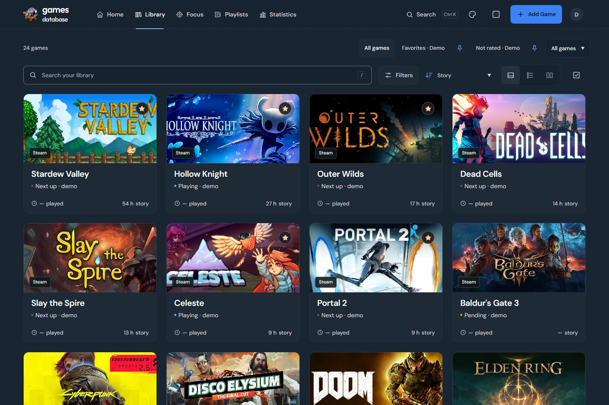
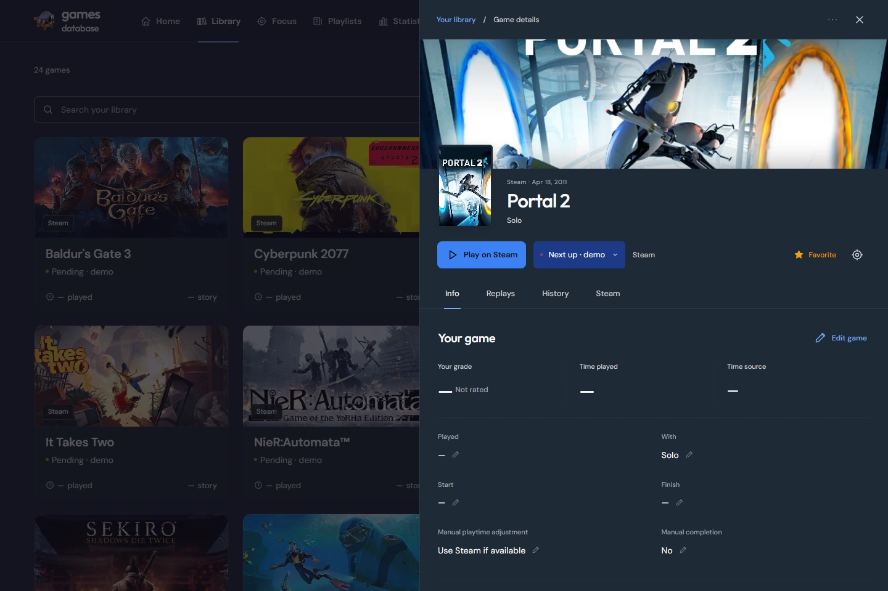
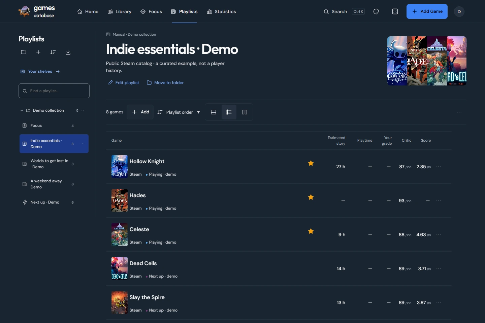
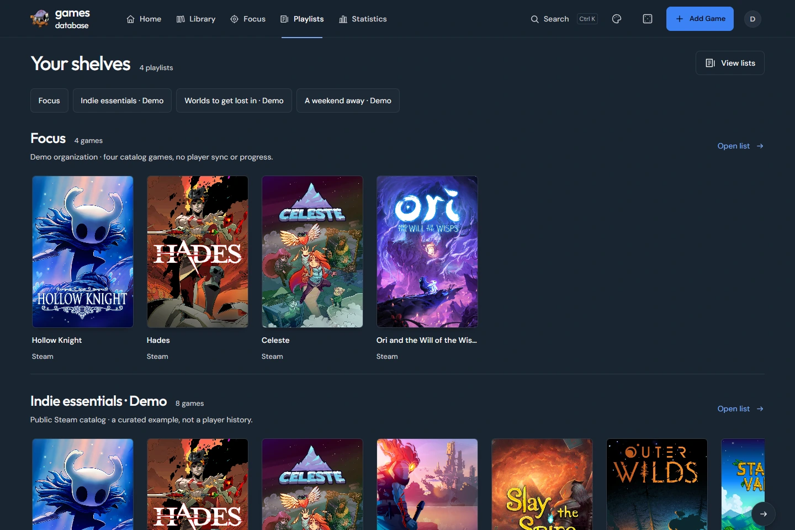
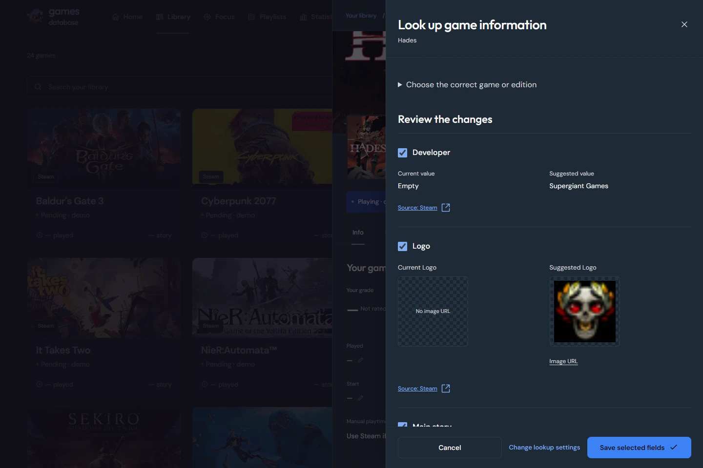
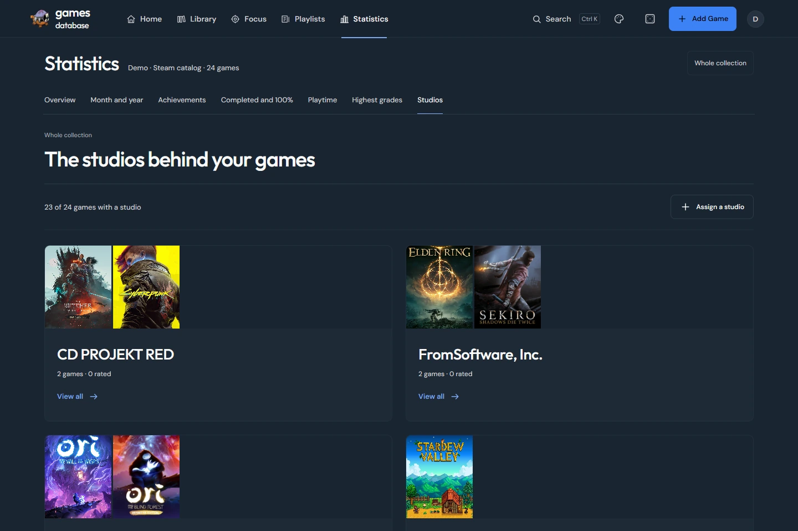

# Games Database

[English](README.md) · [Español](README.es.md) · [API](https://github.com/David-H-Afonso/GamesDatabase.Api) · [Releases](https://github.com/David-H-Afonso/GamesDatabase.Front/releases)

Games Database is a self-hosted app for organizing your game collection and keeping
track of your playthroughs. It runs on your own server, with a separate library for
each user.


## Features

- **A searchable library.** Filter by platform, status, favorites, ratings and more.
  Save useful views and switch between Covers, Cards and Row layouts.
- **Playlists and shelves.** Make an ordered list or let rules build one for you.
  Group playlists in folders, browse their covers on shelves and keep a small
  selection in Focus. Home can show the lists and views you use most.
- **Playthrough records.** Keep dates, time, ratings and notes, with separate records
  for replays and statistics across your collection.
- **Steam and metadata.** Import from Steam, track achievements and review catalog
  information from Steam and Wikidata, critic ratings and HLTB estimates via Deku
  Deals. Autofill batches keep running in the background while you use the app.
- **Your setup.** Choose from 13 themes and English or Spanish. Manage users and
  catalogs, and import or export your library with CSV, JSON and ZIP tools.



## Run locally

You need Node.js **22.13+**, npm **10+**, and the
[Games Database API](https://github.com/David-H-Afonso/GamesDatabase.Api) running.
The [setup guide](docs/GETTING_STARTED.md) covers both repositories and the first account.

```sh
git clone https://github.com/David-H-Afonso/GamesDatabase.Front.git
cd GamesDatabase.Front
npm ci --include=optional
npm run dev
```

Open **http://localhost:5173**. Development uses the local API on HTTPS port 7245,
with HTTP port 5011 as a fallback. To use HTTP directly, add this public URL to
`.env.local`:

```env
VITE_API_URL=http://127.0.0.1:5011/api
```

On a new installation, sign in with the initial administrator and set its password
before sharing access. The getting-started guide walks through adding games and
organizing a library; you can skip it or return to it from the profile menu.

### Configuration

| Setting | Use |
| --- | --- |
| `VITE_API_URL` | API URL for development and build-time configuration |
| `window.ENV.VITE_API_URL` | Browser-facing API URL injected by the web container |
| `API_IMAGES_URL` | API upstream used by the container's image proxy |

These frontend settings must not contain JWT signing keys or Steam API keys.
For containers, image routing and upgrades, see [Deployment](docs/DEPLOYMENT.md).

## Screenshots

<details>
<summary>Game details, playlists, Focus and more</summary>

### Game details



### Playlists



### Shelves



### Focus


### Metadata review



### Statistics



### Appearance


</details>

Screenshots use a demo library. [Artwork credits](docs/SCREENSHOTS.md).

## Development

Built with React 19, TypeScript, Vite, Redux Toolkit and SCSS. Tests use Vitest,
Testing Library, MSW and Cypress.

```sh
npm run build
npm run lint
npm run test
```

[Contributing](CONTRIBUTING.md) covers coverage, browser tests and release checks.
The [architecture guide](docs/ARCHITECTURE.md) explains the application structure.

## Documentation and support

| Guide | Contents |
| --- | --- |
| [Getting started](docs/GETTING_STARTED.md) | Install the API and web client, then create a library |
| [User guide](docs/USER_GUIDE.md) | Games, filters, playlists, Focus and data tools |
| [Metadata and autofill](docs/METADATA_AUTOFILL.md) | Sources, field review and background batches |
| [Deployment and recovery](docs/DEPLOYMENT.md) | Containers, configuration, backups and upgrades |

If the app cannot reach the API, check the browser's API URL and allowed origin.
If game images fail, check the image proxy separately. For missing native modules,
reinstall with `npm ci --include=optional` using the committed lockfile.

Report bugs in [Issues](https://github.com/David-H-Afonso/GamesDatabase.Front/issues).
For security reports, follow [SECURITY.md](SECURITY.md).

## License

[GPL-3.0-or-later](LICENSE.md). Bundled fonts retain their Open Font License notices
in `public/licenses/fonts/`. Game artwork belongs to its respective rights holders.
