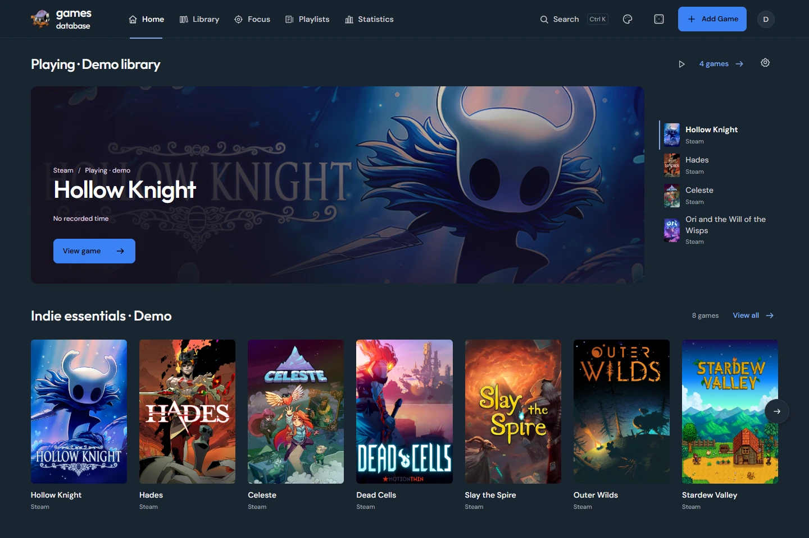
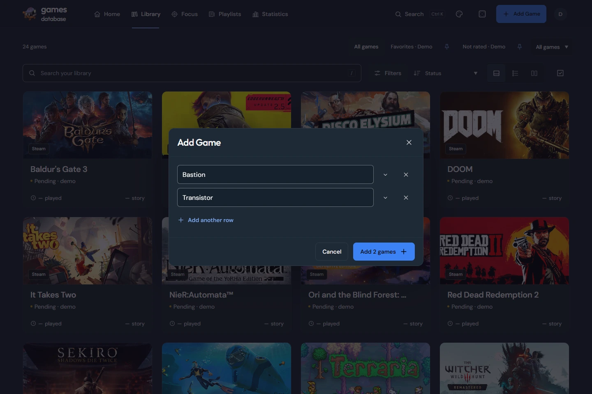
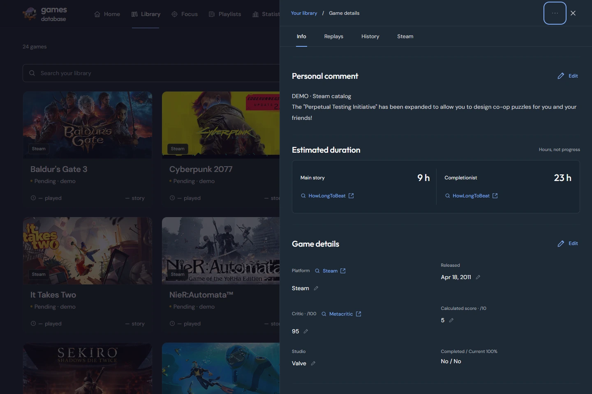
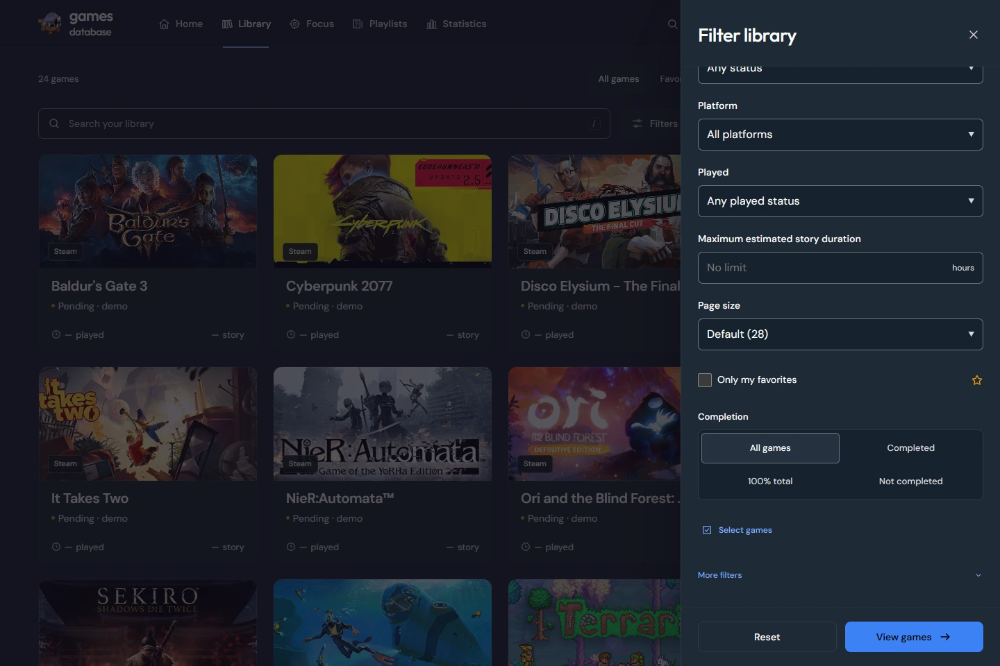
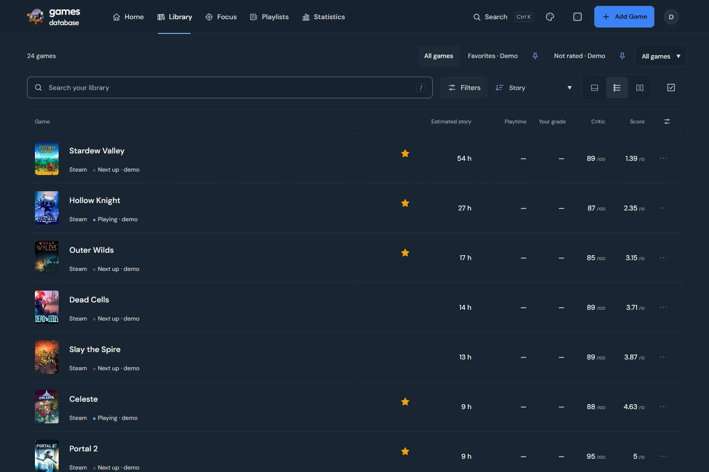
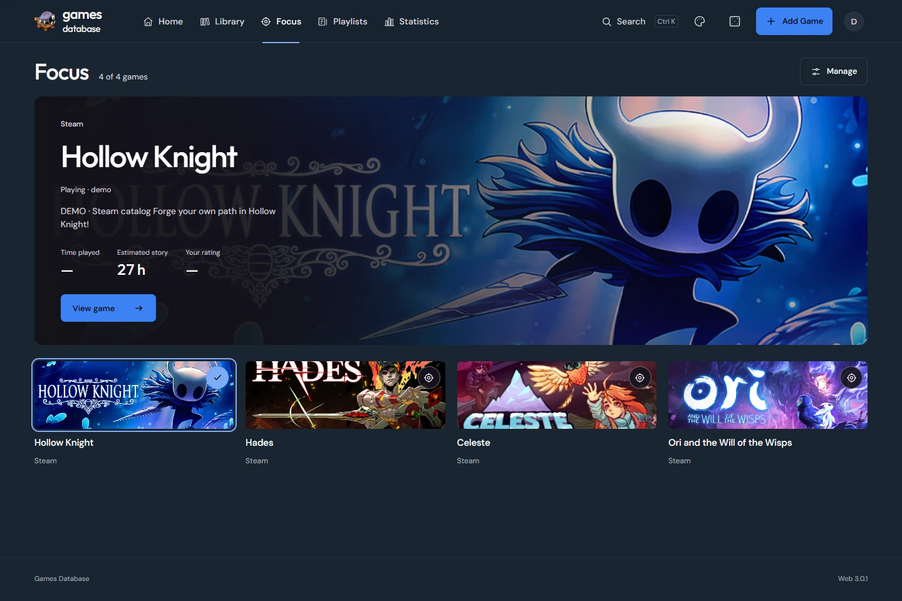
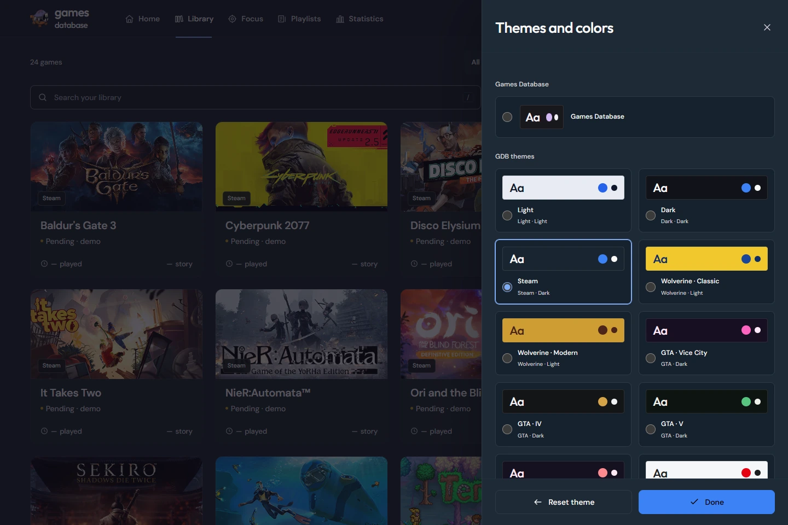

# Games Database

[English](README.md) · [Español](README.es.md) · **Web frontend** ·
[API: English](https://github.com/David-H-Afonso/GamesDatabase.Api/blob/HEAD/README.md) /
[Español](https://github.com/David-H-Afonso/GamesDatabase.Api/blob/HEAD/README.es.md)

**A personal game library that keeps your collection, progress and next game in one place.**

Games Database is a self-hosted React application backed by a multi-user ASP.NET
Core API. Organize games your way, keep playthrough records, connect Steam when
you want to, and revisit the games already in your library.

[Quick start](#quick-start) · [Feature tour](#a-tour-of-your-library) ·
[User guide](docs/USER_GUIDE.md) · [Paired installation](docs/GETTING_STARTED.md)



> **A real app, a separate demo collection.** These captures use 24 famous games and
> public Steam catalog artwork/facts in an isolated account. Statuses, favorites and
> lists illustrate organization; no player's account, unlocks, playtime, grades or
> play dates were copied or invented. [Image sources and capture scope](docs/SCREENSHOTS.md).

**Source and releases:** this guide follows repository source, not a promise that
an uncommitted clone matches the latest image. The verified baseline before the
27 November follow-up was Front **3.0.1** / API **3.0.0**. Check the exact tested
version/SHA in [Web releases](https://github.com/David-H-Afonso/GamesDatabase.Front/releases)
and [API releases](https://github.com/David-H-Afonso/GamesDatabase.Api/releases).
Duration/critic review, pins, reviewed dates and batch autofill require the compatible
newer API; a source feature is not proof that an older image contains it.

## What you can do

- **Build your library:** compact single/batch creation with folded options and an
  adjacent Steam toggle for linked accounts; edit grades, dates, notes, estimates and independent
  Logo, Hero and Cover artwork.
- **Find and organize:** literal phrase/exclusion search, advanced filters, saved
  views with two pinned shortcuts, manual/automatic playlists, folders and cover shelves.
- **Choose your presentation:** Covers, Cards and compact/extended Row; thirteen
  themes, optional backgrounds and English/Spanish throughout the interface.
- **Keep your progress:** separate playthroughs/Replays, change history, manual
  time that replaces or adds to Steam, and distinct base-game/DLC achievement sets.
- **Make Home yours:** reorder, hide and configure rows without changing their
  source playlists. Playing now rotates every 20 seconds while visible, with a quiet
  pause control and interaction/reduced-motion safeguards.
- **Discover your next game:** daily recommendations with included/excluded
  statuses, and a dice action scoped to the whole library or the current page.
- **Fill metadata faster:** Steam/Wikidata facts, correctly attributed Metacritic/
  OpenCritic and optional HLTB estimates from public Deku Deals pages. Review one
  game, autofill an exact selection, or opt in after creation/import.
- **Learn at your pace:** an optional, resumable guide for new or existing users.
  Example games require opt-in; useful tutorial views remain available after the guide.
- **Move and protect your data:** CSV/JSON/ZIP tools, ownership-aware imports,
  backup controls and administration for users and personal catalogs.


## A tour of your library

### 1. Add a title, not a form full of obligations

1. Select **Add Game** and start with a title. When your account is linked to Steam,
   the adjacent icon enables/disables library/Store search for that row. Without linking
   a player, manual creation and the separate public metadata review remain available.
2. Expand secondary options only when you need status, platform or other creation fields.
   Add more rows for a batch; each row retains its own draft and result.
3. If creation succeeded but a following setting failed, review that result rather than
    adding the same game again. Manual retries use a per-row UUID to avoid duplicates.
4. The title receives focus. Your explicit Steam on/off choice is remembered per
   account, including new rows and reopened dialogs. The final **Try to autofill info
   after import** checkbox is separate, defaults off, and preserves successful imports
   and Steam links if metadata fails.



Open a cover or title for the game detail. **Edit game** separates personal data,
catalog information, artwork and Steam linkage. **Logo**, horizontal **Hero** and
vertical **Cover** are independent; previews show the exact role being edited.
Grade/Critic use **/100**, while the calculated Score uses **/10**.




### 2. Find something worth playing

1. Search the Library with phrases and literal exclusions; choose any/all matching
   and separate case/accent sensitivity in the search options.
2. Open **Filters**. Page size sits above Favorites, with Completed and 100% immediately
   below; less frequent criteria remain under **More filters**. **View games** applies
   the draft. Closing it does not quietly change your query.
3. Save a useful view and pin up to **two** shortcuts. Pinned positions stay fixed;
   unpinned positions use recent views. Hover, keyboard focus and the mobile selector
   all expose the pin action. A third pin never displaces your existing choices.



Switch **Covers / Cards / Row** independently of your filters. Cards starts at four
columns when space permits, keeps an explicit three-column choice and adapts on mobile.
Extended Row exposes more comparison fields. Start selection to act on a whole card/row
without accidentally opening its detail. The separate global search remains available
with **Ctrl/⌘ K**; it is not a replacement for the Library query.



### 3. Make playlists, not duplicate libraries

Create a **manual playlist** for an ordered shortlist or an **automatic playlist** from
reviewed rules. Optional recipes give the form a starting point, never silently create
lists. Set a capacity if useful, group lists in folders, move them directly and reorder
with pointer/keyboard controls or the alternative move selector.


**Shelves** presents those same manual playlists as cover rails. Opening a shelf returns
to its actual source list; it does not create another collection or a separate catalog.


### 4. Keep a small Focus, customize a broader Home

Use **Focus → Manage** to choose up to four games in your manual Focus playlist.
Open a banner for details; the separate spotlight control changes the featured game
without reordering the playlist. Linked visible games can sync once on entry, not on
a recurring timer. The screenshot uses unlinked catalog records, not invented Steam progress.



On **Home**, use the settings button to reorder/hide rows and choose playlists, saved
views, filters, Playing now, recommendations or statistics as sources. Preview a row,
then **Save row** and **Save Home**. Removing a row never deletes its source playlist.
The dice offers **whole library** or the **exact games currently displayed**, not an
unseen page of matches. Recommendations disclose their shared **00:00 UTC** refresh.

### 5. Review information, artwork and estimates before saving

From a game's options, choose **Fill information automatically**. Select empty-only or
overwrite mode and whether to include critic/artwork/durations. Check the matched edition,
the current/proposed values and each source, then save only the fields you want.


Ordinary facts come from Steam, then Wikidata when needed. Optional story/completionist
estimates are HLTB figures published by **Deku Deals**, not Steam playtime. Exact source
hours and the proposed whole-hour rounding are shown before saving. There is no direct
HLTB scraping, new API key or challenge bypass. A missing/ambiguous source does not clear
your fields, and lookup does not import a player's progress.

Critic priority is Steam-edition Metacritic, then Metacritic and OpenCritic attributed
by Deku; the real provider is saved. Listed-platform differences are disclosed.
SteamDB is not scraped, and a Steam user-review percentage is not newly labelled as
its critic score. Replace searches populated groups too; verified no-ops do not invent edits.

Library selection exposes lightning **Autofill** beside a separately confirmed
**Replace** mode. Empty-only is the default. Batches retain exact IDs, per-game
progress and partial results, with metadata-only retry. Artwork refresh remains a
separate role-only operation, not player sync. See [Metadata review and batch
autofill](docs/METADATA_AUTOFILL.md) for cancellation, ambiguity and recovery.


### 6. Record your own progress, without guessing a history

- Keep dates, grades, notes and **Replays** separately for each playthrough; inspect
  field history when something changes.
- Positive manual minutes replace Steam by default, or explicitly **add to Steam**.
  Zero/empty returns to Steam. Estimates and accumulated playtime remain different things.
- Steam detail separates base game/DLC sets, hidden-achievement reveal, rarity and
  partial progress. Blue **Completed** and gold **100%** have different definitions.
- **Look for Steam dates** in detail or Administration offers references for empty
  fields. Select Start/Finish separately after checking source and timezone. Nothing
  is preselected or saved automatically; existing dates stay, and later sync cannot
  move an accepted finish. Last activity does not prove a story ending.
- Statistics uses the **Finish / Start** buttons consistently across overview, months
  and period rankings. Developer grouping uses explicit catalog data. Undated games
  are not assigned to a year from lifetime hours, and achievement activity is separate.


### 7. Learn, personalize and keep a way out

The profile menu opens the resumable guide, appearance, data tools and administration.
The guide can create six **fictional, labelled examples** only after you choose them;
these built-in examples are different from the public Steam collection used in these
screenshots. Its optional Favorites / Not rated / Short games views are normal retained
views. Cleanup reviews the sample batch and keeps edited games by default, not your views.


Choose among **13 themes**, optional backgrounds and English/Spanish. These are real
settings, not different builds. Administration retains user/catalog/view and Steam tools;
the profile's CSV/JSON/ZIP actions expose their transfer scopes before use. A full SQLite
backup is still required for complete authentication/history/cache recovery.



The [user guide](docs/USER_GUIDE.md) expands these workflows, including errors, conflicts,
imports, completion policy and cleanup. [Deployment and recovery](docs/DEPLOYMENT.md)
covers the operational steps that a screenshot cannot certify.

## Quick start

### Requirements

- Node.js **22.13+** or a newer supported release; CI uses Node 22.
- npm **10+** and the committed root `package-lock.json`.
- [GamesDatabase.Api](https://github.com/David-H-Afonso/GamesDatabase.Api) **3.0**
  running at a URL your browser can reach.

```sh
git clone https://github.com/David-H-Afonso/GamesDatabase.Front.git
cd GamesDatabase.Front
npm ci --include=optional
npm run dev
```

Open `http://localhost:5173`. The development API defaults to local HTTPS on port 7245,
with HTTP on port 5011 as fallback. To choose the local HTTP API explicitly, use a private
local `.env` containing the browser-public URL:

```env
VITE_API_URL=http://127.0.0.1:5011/api
```

Do not put JWT signing keys, Steam keys or other server secrets in Front variables.
Vite proxies `/game-images` to the local API in development. For the full paired
setup and a fresh account, follow [Get started](docs/GETTING_STARTED.md).

## First use

1. Sign in to your own account. A fresh installation offers the bootstrap
   administrator; set its password before sharing access.
2. Choose **Use my library** or explicitly add six labelled example games in the
   guide. Skipping the guide never adds sample records.
3. Add a game, open its detail and use **Edit game** to save changed fields.
4. Create playlists or add a small selection to Focus. Customize Home separately.
5. Use recommendations or the dice when you want to revisit your collection.

The profile menu can resume/restart the guide and manage remaining examples.
Administrators can enable the guide when creating or editing a user.

## Development and verification

```sh
npm run build
npm run lint
npm run test
npm run test:coverage
npm run test:i18n
npm run test:ui-contrast
npm run test:versioning
node scripts/ci/native-lock.mjs
node scripts/ci/native-lock.mjs --installed
npm run security:all
```

For browser tests, build first, start the static preview in another terminal and
run Cypress against that artifact:

```sh
npm run build
npm run preview -- --host 127.0.0.1 --port 5174 --strictPort
```

```sh
npm run cypress:run -- --browser electron --config baseUrl=http://127.0.0.1:5174
```

Cypress uses synthetic authentication and intercepted, contract-shaped API
fixtures. Unmatched API traffic is blocked; never point these tests at personal
or production data. Its Electron test browser is not the separate desktop app.

## Architecture and decisions

React 19/TypeScript/Vite 7, Redux Toolkit, React Router 7, SCSS, Vitest, Testing
Library, MSW and Cypress. DM Sans and Outfit are served locally.

The frontend keeps HTTP contracts in `src/services` and `src/models`. Collection
reads are keyed by account/query, cancelled when stale, and separated from
explicit mutations. Detail and metadata hosts live outside replaceable result
cards so a list refresh does not discard an open workflow.

- **Sparse editing:** Save sends changed fields, not a whole stale game snapshot.
- **Independent artwork:** a missing Hero is not substituted with a vertical Cover.
- **Explicit data changes:** lookups do not sync players; templates and samples
  are not silently created; concurrent saves are surfaced for review.
- **Server-owned discovery:** all accounts share the UTC day boundary, while each
  recommendation pool and random result is scoped to its own collection.

See [Architecture](docs/ARCHITECTURE.md) and [Contributing](CONTRIBUTING.md).

## Data definitions and boundaries

Positive manual minutes replace Steam lifetime minutes by default. **Zero or
empty manual time uses Steam**; **Add manual time to Steam** sums both sources.
Raw Steam/manual values remain separate in the editor and transfers.
Story/completionist estimates are hours, not progress percentages. Completed
includes preserved/manual/set completion; strict 100% requires all current public
base-game and DLC achievements. Replays retain their own dates and grades, not an
invented duration or monthly-session history.

Steam Store availability, Wikidata coverage and attributed Deku Deals duration coverage
can vary. Estimates are sourced suggestions, not guaranteed times or player sessions;
rounding is disclosed before saving. Reviewed lookup retains existing fields when a
source is missing or ambiguous. Steam dates are opt-in activity references, never
automatically verified start/finish dates.
Examples are labelled library records and count in totals until kept or removed.

This repository is the **web frontend**, not an Electron release. A local passing
test run is not certification of deployment, physical devices or screen readers.
Production requires review of its actual hosting, access policy and recovery plan.

## Deploying and releasing

`npm run build` produces `dist/`. The web container injects the public
`window.ENV.VITE_API_URL`; `API_IMAGES_URL` configures its Nginx image upstream.
Browser and container URLs are separate concerns.

Adopt the compatible API first and follow [Deployment and recovery](docs/DEPLOYMENT.md).
A push may publish images/releases but does not authorize production startup or
database restoration. Versions are checked per commit by the
[version kit](scripts/versioning/README.md). An explicit `Release-As: 3.0.0`
trailer records the owner's product milestone without inventing an API break.

## Troubleshooting and support

- **Native module missing:** use the portable lock and `npm ci --include=optional`;
  do not regenerate it from platform-pruned dependencies. Run the native guards.
- **API/images unavailable:** check the browser API URL and image proxy separately.
- **409 conflict:** reload the latest data and review the draft; do not force overwrite.
- **Database busy (503):** retain a successful import's receipt and retry only unfinished
  settings when necessary; do not resubmit the whole import blindly.
- **No Steam date reference:** the provider may omit last played or have no reliable
  cached event. Enter a known personal date, or leave it unknown rather than guessing.
- **No recommendations:** adjust statuses or add eligible games. A small pool may
  repeat games; selection ordering rotates daily.
- **Example cleanup conflict:** reload/review; another edit must not be discarded.

Report reproducible bugs in [Issues](https://github.com/David-H-Afonso/GamesDatabase.Front/issues).
For contribution checks, see [Contributing](CONTRIBUTING.md). Sensitive reports
follow [Security](SECURITY.md), not public issue disclosure.

## License

The application retains its [GPL-3.0 license](LICENSE.md). Bundled fonts retain
their original SIL Open Font License notices in `public/licenses/fonts/`; those
notices and the application license ship with the static artifact. Game artwork
belongs to its respective rights holders. The opt-in sample illustrations are
distributed with the application, not presented as third-party game editions.
