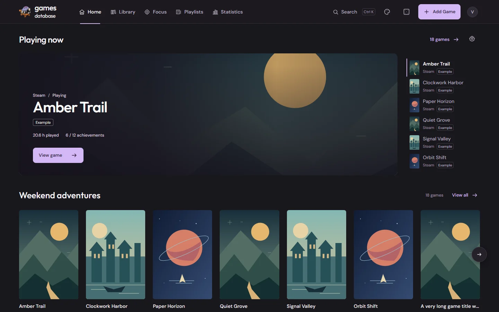
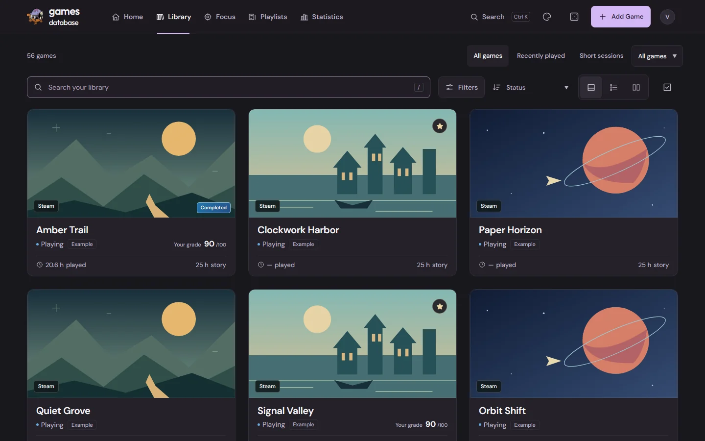
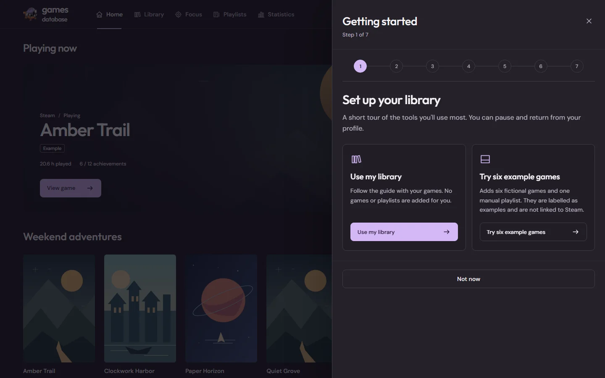

# Games Database

**A personal game library that keeps your collection, progress and next game in one place.**

Games Database is a self-hosted React application backed by a multi-user ASP.NET
Core API. Organize games your way, keep playthrough records, connect Steam when
you want to, and revisit the games already in your library.

[Español](README.es.md) · [Get started](docs/GETTING_STARTED.md) ·
[User guide](docs/USER_GUIDE.md) · [API](https://github.com/David-H-Afonso/GamesDatabase.Api)



Screenshots show the running application with isolated synthetic records and
the bundled fictional sample artwork, not personal player data or production.

## What you can do

- **Build your library:** compact single/batch creation with an adjacent Steam
  toggle and folded options; edit grades, dates, notes, estimates and independent
  Logo, Hero and Cover artwork.
- **Find and organize:** literal phrase/exclusion search, advanced filters, saved
  views, manual/automatic playlists, folders and cover shelves.
- **Choose your presentation:** Covers, Cards and compact/extended Row; thirteen
  themes, optional backgrounds and English/Spanish throughout the interface.
- **Keep your progress:** separate playthroughs/Replays, change history, manual
  time that replaces or adds to Steam, and distinct base-game/DLC achievement sets.
- **Make Home yours:** reorder, hide and configure rows without changing their
  source playlists. Playing now has a separate, unobtrusive game list.
- **Discover your next game:** daily recommendations with included/excluded
  statuses, and a dice action scoped to the whole library or the current page.
- **Fill metadata faster:** Steam-first, Wikidata-second lookups with field-level
  sources, empty-only/overwrite choices and an explicit review before saving.
- **Learn at your pace:** an optional, resumable guide for new or existing users.
   Example games require opt-in and can be kept or reviewed for removal.
- **Move and protect your data:** CSV/JSON/ZIP tools, ownership-aware imports,
  backup controls and administration for users and personal catalogs.



## Quick start

### Requirements

- Node.js **22.13+** or a newer supported release; CI uses Node 22.
- npm **10+** and the committed root `package-lock.json`.
- [GamesDatabase.Api](https://github.com/David-H-Afonso/GamesDatabase.Api) **3.0**
  running at a URL your browser can reach.

```sh
git clone https://github.com/David-H-Afonso/GamesDatabase.Front.git
cd GamesDatabase.Front
npm ci --include=optional
npm run dev
```

Open `http://localhost:5173`. The development API defaults to local HTTPS on port 7245,
with HTTP on port 5011 as fallback. To choose the local HTTP API explicitly, use a private
local `.env` containing the browser-public URL:

```env
VITE_API_URL=http://127.0.0.1:5011/api
```

Do not put JWT signing keys, Steam keys or other server secrets in Front variables.
Vite proxies `/game-images` to the local API in development. For the full paired
setup and a fresh account, follow [Get started](docs/GETTING_STARTED.md).

## First use

1. Sign in to your own account. A fresh installation offers the bootstrap
   administrator; set its password before sharing access.
2. Choose **Use my library** or explicitly add six labelled example games in the
   guide. Skipping the guide never adds sample records.
3. Add a game, open its detail and use **Edit game** to save changed fields.
4. Create playlists or add a small selection to Focus. Customize Home separately.
5. Use recommendations or the dice when you want to revisit your collection.

The profile menu can resume/restart the guide and manage remaining examples.
Administrators can enable the guide when creating or editing a user.




## Development and verification

```sh
npm run build
npm run lint
npm run test
npm run test:coverage
npm run test:i18n
npm run test:versioning
node scripts/ci/native-lock.mjs
node scripts/ci/native-lock.mjs --installed
npm run security:all
```

For browser tests, build first, start the static preview in another terminal and
run Cypress against that artifact:

```sh
npm run build
npm run preview -- --host 127.0.0.1 --port 5174 --strictPort
```

```sh
npm run cypress:run -- --browser electron --config baseUrl=http://127.0.0.1:5174
```

Cypress uses synthetic authentication and intercepted, contract-shaped API
fixtures. Unmatched API traffic is blocked; never point these tests at personal
or production data. Its Electron test browser is not the separate desktop app.

## Architecture and decisions

React 19/TypeScript/Vite 7, Redux Toolkit, React Router 7, SCSS, Vitest, Testing
Library, MSW and Cypress. DM Sans and Outfit are served locally.

The frontend keeps HTTP contracts in `src/services` and `src/models`. Collection
reads are keyed by account/query, cancelled when stale, and separated from
explicit mutations. Detail and metadata hosts live outside replaceable result
cards so a list refresh does not discard an open workflow.

- **Sparse editing:** Save sends changed fields, not a whole stale game snapshot.
- **Independent artwork:** a missing Hero is not substituted with a vertical Cover.
- **Explicit data changes:** lookups do not sync players; templates and samples
  are not silently created; concurrent saves are surfaced for review.
- **Server-owned discovery:** all accounts share the UTC day boundary, while each
  recommendation pool and random result is scoped to its own collection.

See [Architecture](docs/ARCHITECTURE.md) and [Contributing](CONTRIBUTING.md).

## Data definitions and boundaries

Positive manual minutes replace Steam lifetime minutes by default. **Zero or
empty manual time uses Steam**; **Add manual time to Steam** sums both sources.
Raw Steam/manual values remain separate in the editor and transfers.
Story/completionist estimates are hours, not progress percentages. Completed
includes preserved/manual/set completion; strict 100% requires all current public
base-game and DLC achievements. Replays retain their own dates and grades, not an
invented duration or monthly-session history.

Metadata sources do not provide verified story/completionist estimates; those
values remain unchanged. Steam Store availability and Wikidata coverage can vary.
The reviewed lookup retains existing fields when a source is missing or ambiguous.
Examples are labelled library records and count in totals until kept or removed.

This repository is the **web frontend**, not an Electron release. A local passing
test run is not certification of deployment, physical devices or screen readers.
Production requires review of its actual hosting, access policy and recovery plan.

## Deploying and releasing

`npm run build` produces `dist/`. The web container injects the public
`window.ENV.VITE_API_URL`; `API_IMAGES_URL` configures its Nginx image upstream.
Browser and container URLs are separate concerns.

Adopt the compatible API first and follow [Deployment and recovery](docs/DEPLOYMENT.md).
A push may publish images/releases but does not authorize production startup or
database restoration. Versions are checked per commit by the
[version kit](scripts/versioning/README.md). An explicit `Release-As: 3.0.0`
trailer records the owner's product milestone without inventing an API break.

## Troubleshooting and support

- **Native module missing:** use the portable lock and `npm ci --include=optional`;
  do not regenerate it from platform-pruned dependencies. Run the native guards.
- **API/images unavailable:** check the browser API URL and image proxy separately.
- **409 conflict:** reload the latest data and review the draft; do not force overwrite.
- **No recommendations:** adjust statuses or add eligible games. A small pool may
  repeat games; selection ordering rotates daily.
- **Example cleanup conflict:** reload/review; another edit must not be discarded.

Report reproducible bugs in [Issues](https://github.com/David-H-Afonso/GamesDatabase.Front/issues).
For contribution checks, see [Contributing](CONTRIBUTING.md). Sensitive reports
follow [Security](SECURITY.md), not public issue disclosure.

## License

The application retains its [GPL-3.0 license](LICENSE.md). Bundled fonts retain
their original SIL Open Font License notices in `public/licenses/fonts/`; those
notices and the application license ship with the static artifact. Game artwork
belongs to its respective rights holders. The opt-in sample illustrations are
distributed with the application, not presented as third-party game editions.
